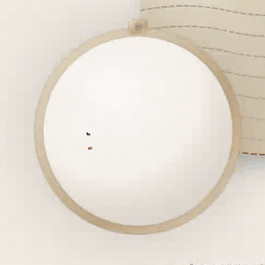
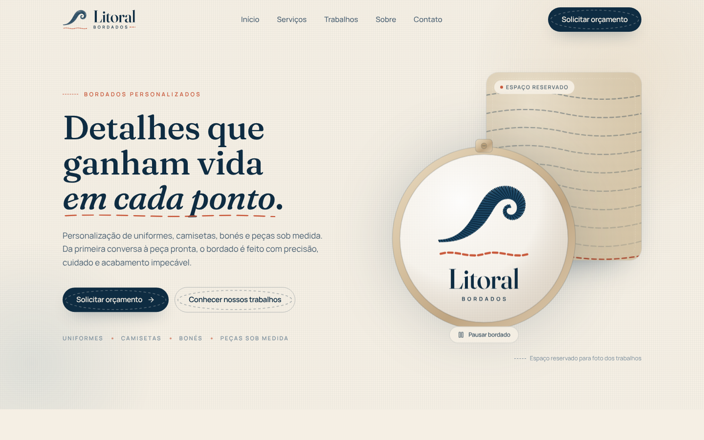
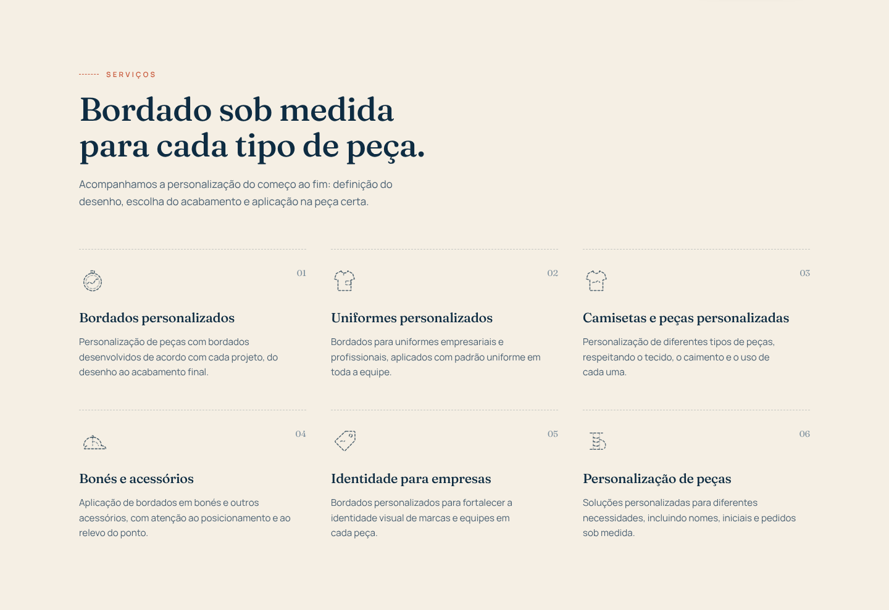
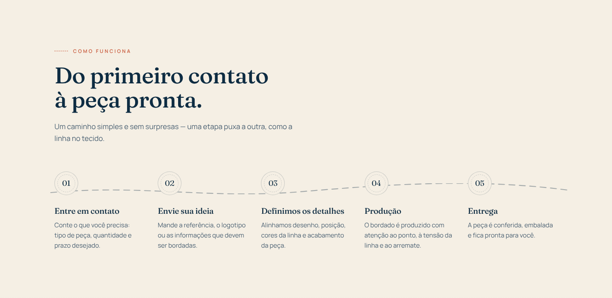
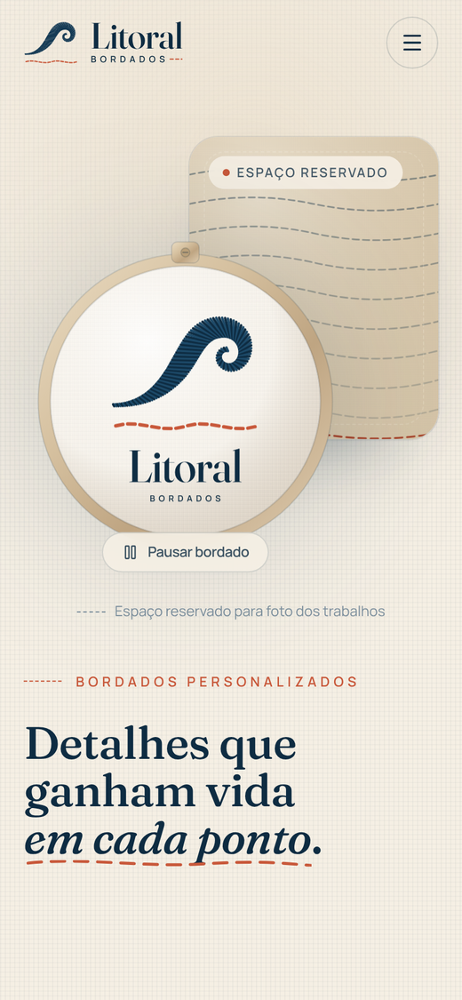

# Litoral Bordados

Landing page da **Litoral Bordados**, empresa de bordados personalizados para uniformes, camisetas, bonés e peças sob medida.

**No ar:** [litoralbordados.com](https://litoralbordados.com)

<p align="center">
  
</p>

## A ideia

Bordado é feito ponto a ponto, e a página conta isso logo no primeiro segundo. No topo, um bastidor recebe a linha: a agulha costura o pesponto da orla, troca de linha, preenche a onda em ponto cheio e, por último, borda o nome da marca. É o mesmo desenho da logo, então a animação, a logo e o favicon nascem do mesmo traço.

A linguagem continua no resto da página: pespontos marcam títulos e divisões, cada diferencial vem com uma amostra de ponto de verdade (nó francês, corrente, cheio, cruz, atrás e haste) e um fio corre entre as etapas do atendimento.



## O que tem na página

- **Topo** com a animação "Do fio ao bordado", chamada para orçamento e os tipos de peça.
- **Serviços:** seis tipos de personalização, cada um com ícone desenhado em pesponto.
- **Trabalhos:** grade para as fotos das peças bordadas.
- **Sobre e diferenciais**, com as amostras de ponto.
- **Como funciona:** do primeiro contato à entrega, em cinco etapas.
- **Contato:** botão de WhatsApp que abre a conversa com a mensagem já escrita, além de telefone, e-mail e Instagram. Cada canal só aparece depois de cadastrado.

| | |
| --- | --- |
|  |  |

<p align="center">
  
</p>

## Detalhes de construção

- **Animação feita à mão**, com SVG, CSS e um laço de `requestAnimationFrame`, sem biblioteca de animação. Ela roda em laço só enquanto o bastidor está visível e pausa sozinha fora da tela.
- **Botão de pausa** para o bordado, já que conteúdo em laço precisa poder ser parado (WCAG 2.2.2).
- **Movimento reduzido respeitado:** com `prefers-reduced-motion`, o bordado já aparece pronto e a rolagem fica normal. Sem JavaScript, a página continua completa e legível.
- **Rolagem com inércia e parallax** entre as camadas de cada seção, mais suave no celular, onde o toque continua nativo.
- **Identidade desenhada em código:** a curva da onda gera a logo, as variações para fundo escuro, o favicon e a animação.
- **Contatos à prova de link quebrado:** canal não informado simplesmente não aparece.
- **SEO completo:** Open Graph, dados estruturados (`Organization`), `sitemap.xml` e `robots.txt`.
- **Site estático** publicado na Cloudflare: cada push na `main` gera e publica uma nova versão.

## Tecnologias

- [Next.js 16](https://nextjs.org) (App Router, exportação estática)
- React 19 e TypeScript
- [Tailwind CSS 4](https://tailwindcss.com)
- [Lenis](https://lenis.darkroom.engineering) para a inércia da rolagem
- [Lucide](https://lucide.dev) para ícones de interface
- Cloudflare Workers (arquivos estáticos) e domínio próprio

## Rodando

Requisito: Node.js 20.9 ou superior.

```bash
npm install
npm run dev        # http://localhost:3000
```

Para ver a versão compilada, servida do mesmo jeito que em produção:

```bash
npm run build
npm run preview    # http://localhost:8787
```

O guia de manutenção (onde trocar contatos, textos, fotos e logo, como ajustar a animação e como publicar) está em [`docs/MANUTENCAO.md`](docs/MANUTENCAO.md).

## Créditos

Design e desenvolvimento: [Saymon Oliveira](https://saymonthedev.com), para a Litoral Bordados.
